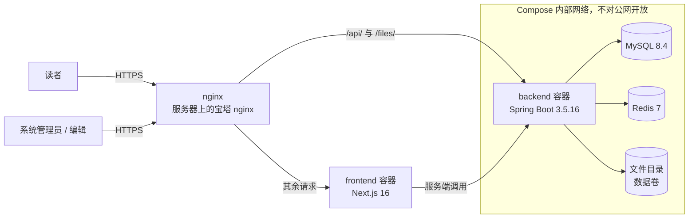

# 系统架构

## 整体架构



- 一个后端应用、一个前端应用、一个数据库、一个 Redis。这是**模块化单体**：按业务分包，不拆服务。
- 前后端**同源**：生产环境由 nginx 按路径分流，开发环境由 Next.js 把 `/api` 和 `/files` 转给后端。这样登录 Cookie 不涉及跨域。
- 展示端由 Next.js 服务端渲染，公开文档对搜索引擎友好；管理端是客户端渲染。

## 仓库结构

```
docHub/
├── AGENTS.md                Agent 的工作规则：文档地图、分工、OpenSpec 流程
├── README.md
├── .agents/skills/           OpenSpec 的六个工作流技能（.zcode/skills/ 里是链接）
├── docs/
│   ├── overview.md          目标、角色、流程、范围
│   ├── domain-model.md      术语表、实体、业务规则
│   ├── architecture.md      本文档
│   ├── development-guide.md 工作流程、环境、命令、风险
│   ├── api-conventions.md   接口约定与清单
│   ├── database-conventions.md  表设计约定与结构
│   ├── decisions/           架构决策记录（ADR）
│   └── learning/            每周的学习目标、安排与复盘
├── openspec/
│   ├── config.yaml          OpenSpec 项目配置
│   ├── specs/               已经实现的能力（事实）
│   └── changes/             进行中的变更；archive/ 存放已归档的
├── deploy/                  compose 文件、nginx 配置片段、备份脚本（随开发逐步建立）
├── backend/                 Spring Boot（Maven，单模块）
│   ├── pom.xml
│   └── src/
│       ├── main/java/dev/dochub/…
│       ├── main/resources/  application*.yml、db/migration/
│       └── test/java/…
└── frontend/                Next.js 16（pnpm）
    ├── app/(portal)/        展示端路由
    ├── app/(admin)/         管理端路由
    ├── proxy.ts             管理端路由的登录检查
    └── lib/api/             请求封装
```

## 后端包结构

按业务分包，每个包内部再分层。跨业务的规则集中放在 `access` 和 `common`。

```
dev.dochub
├── DocHubApplication.java
├── common/        统一返回、错误码、业务异常、全局异常处理、MyBatis-Plus 与 Redis 配置
├── auth/          登录、JWT 签发与解析、Spring Security 配置、当前用户
├── user/          用户、成员分配
├── productline/   产品线
├── productversion/产品版本：增改、上线、下线、复制
├── category/      分类树、分类名
├── document/      文档
├── content/       语言版本：草稿、净化；lock/ 编辑锁
├── publishing/    发布、下线、修订、回滚、译文过期
├── file/          图片上传与访问
├── access/        AccessChecker：数据级鉴权
└── portal/        展示端只读接口
```

每个业务包里是 `controller/`、`service/`、`mapper/`、`entity/`、`dto/`。

## 分层职责

| 层 | 职责 | 不该做的事 |
|---|---|---|
| Controller | 接收请求、参数校验、调用一个 Service 方法、组装响应 | 不写业务规则，不直接调 Mapper |
| Service | 业务规则、权限校验、事务边界 | 不碰 HTTP 对象 |
| Mapper | 数据访问 | 不写业务判断 |
| DTO | 接口的入参和出参 | 不直接把数据库实体返回给前端 |
| Entity | 与表一一对应 | 不带业务方法 |

## 技术选型及原因

| 技术 | 版本 | 选择原因 |
|---|---|---|
| JDK | 21（LTS） | 本机已装；Spring Boot 3.5 支持 |
| Spring Boot | 3.5.16 | 教程和 AI 辅助最充分，见 ADR-005 |
| Maven | 3.8.1（用 wrapper 固定） | 本机已有 |
| MySQL | 8.4（LTS） | 你的选型；窗口函数和递归 CTE 都可用 |
| MyBatis-Plus | 3.5.18（`mybatis-plus-spring-boot3-starter`） | SQL 可见，国内企业常用 |
| Flyway | 由 Boot 管理（11.7.2） | 表结构有版本、可重现；MySQL 需另加 `flyway-mysql` |
| Spring Security | 由 Boot 管理（6.5.11） | 认证和授权的标准方案 |
| JWT | jjwt 0.13.0 | 轻量，API 与 0.12 一致 |
| Redis | 7，客户端用 Spring Data Redis（Lettuce） | 只用于编辑锁；原生过期时间，见 ADR-004 |
| HTML 净化 | Jsoup 1.24.1 | 成熟的白名单净化 |
| 接口文档 | springdoc 2.10.1 | 只在开发环境开启 |
| 测试 | JUnit 5、Spring Boot Test、Testcontainers（由 Boot 管理，1.21.4） | 用真实的 MySQL 和 Redis 做集成测试 |
| 前端 | Next.js 16.4、React 19、Ant Design 6.7 | 你的选型；展示端可直接服务端渲染 |
| 编辑器 | `@textory/editor` 0.0.1 | 你自己的编辑器，功能齐全 |
| 包管理 | pnpm | 你的选型 |
| 容器 | Docker、Compose v2 | 本机和服务器都有 |

**注意事项**

- Testcontainers 用 Boot 管理的 1.21.4，不要自行升到 2.x。依赖是 `org.testcontainers:mysql`，Redis 用 `GenericContainer`。
- 不用 Redisson：它的锁是为“一段代码执行期间”设计的，不适合“一个人编辑半小时”。
- `@textory/standalone` 没有发布到 npm。展示端的只读渲染要么先发布这个包，要么用 `editable={false}` 的编辑器，在第 9 周前决定。

---
