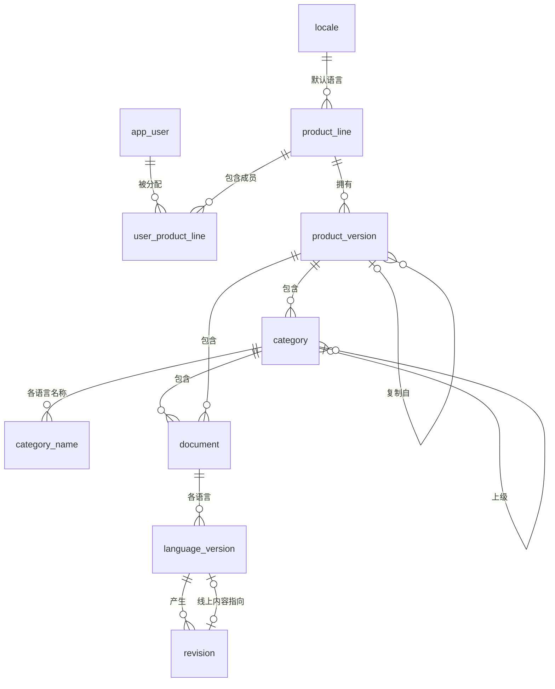

# 数据库约定

本文件分两部分：所有表都要遵守的通用约定，以及当前设计（表结构、约束、索引、事务场景）。术语见 [domain-model](./domain-model.md)。

## 通用约定

- 表名和字段名用小写下划线，表名用单数（`document`，不是 `documents`）；不用 SQL 保留字当表名。
- 主键一律 `BIGINT AUTO_INCREMENT`，只在库内做关联。对外的稳定标识另设字段，例如 `document.doc_key`。
- 字符集 `utf8mb4`；时间用 `DATETIME`；布尔用 `TINYINT(1)`；正文用 `LONGTEXT`。
- 审计字段：`created_at`、`updated_at`、`created_by`、`updated_by`，前两个由 MyBatis-Plus 自动填充。
- 业务上的唯一性必须落到唯一约束，不能只靠“先查再插”。捕获唯一键冲突后转成 409。
- 外键默认 RESTRICT：有下级数据时不允许删除。需要级联的明确说明；代码里仍然按顺序显式删除，不依赖级联。
- 每个迁移脚本只前进：文件名 `V{n}__{描述}.sql`，已执行的脚本不可修改；表结构有变就写新的脚本。
- 索引只为真实的查询建，先看执行计划再加。

## 当前设计

## ER 关系图

`language_version` 到 `revision` 的“线上内容指向”没有建物理外键，原因见下文“需要重点关注的数据一致性问题”。

## 数据表字段设计

约定：主键都是 `BIGINT AUTO_INCREMENT`；`audit` 代表 `created_at`、`updated_at`（`DATETIME NOT NULL`）和 `created_by`、`updated_by`（`BIGINT NULL`）；字符集 `utf8mb4`。

**locale**

| 字段 | 类型 | 约束 | 说明 |
|---|---|---|---|
| code | VARCHAR(10) | 主键 | BCP 47 标签，如 `zh-CN` |
| name | VARCHAR(50) | 非空 | 显示名，如“简体中文” |

**app_user**

| 字段 | 类型 | 约束 | 说明 |
|---|---|---|---|
| id | BIGINT | 主键 | |
| username | VARCHAR(50) | 非空，唯一 | |
| password_hash | VARCHAR(100) | 非空 | BCrypt 结果 |
| display_name | VARCHAR(50) | 非空 | |
| role | VARCHAR(20) | 非空 | `ADMIN`、`EDITOR` |
| enabled | TINYINT(1) | 非空，默认 1 | |
| audit | | | |

**product_line**

| 字段 | 类型 | 约束 | 说明 |
|---|---|---|---|
| id | BIGINT | 主键 | |
| code | VARCHAR(50) | 非空，唯一 | 用于展示端地址，创建后不可改 |
| name | VARCHAR(100) | 非空 | |
| default_locale | VARCHAR(10) | 非空，外键 → `locale.code`，RESTRICT | 默认语言 |
| sort_order | INT | 非空，默认 0 | |
| enabled | TINYINT(1) | 非空，默认 1 | |
| audit | | | |

**user_product_line**

| 字段 | 类型 | 约束 | 说明 |
|---|---|---|---|
| id | BIGINT | 主键 | |
| user_id | BIGINT | 非空，外键 → `app_user.id`，RESTRICT | |
| product_line_id | BIGINT | 非空，外键 → `product_line.id`，CASCADE | 联合唯一 `(user_id, product_line_id)` |
| created_at | DATETIME | 非空 | |

**product_version**

| 字段 | 类型 | 约束 | 说明 |
|---|---|---|---|
| id | BIGINT | 主键 | |
| product_line_id | BIGINT | 非空，外键 → `product_line.id`，RESTRICT | 联合唯一 `(product_line_id, name)` |
| name | VARCHAR(50) | 非空 | 如 `2.0.0`、`2025`、`v3` |
| status | VARCHAR(20) | 非空 | `OFFLINE` 未上线、`ONLINE` 已上线 |
| sort_order | INT | 非空，默认 0 | 版本名不保证能按字符串排序，顺序由人定 |
| cloned_from_version_id | BIGINT | 可空，外键 → `product_version.id`，RESTRICT | 复制来源 |
| went_online_at | DATETIME | 可空 | 首次上线时间 |
| audit | | | |

**category**

| 字段 | 类型 | 约束 | 说明 |
|---|---|---|---|
| id | BIGINT | 主键 | |
| product_version_id | BIGINT | 非空，外键 → `product_version.id`，CASCADE | |
| parent_id | BIGINT | 可空，外键 → `category.id`，RESTRICT | 为空是顶级分类；RESTRICT 保证非空分类删不掉 |
| sort_order | INT | 非空，默认 0 | 同级内的顺序 |
| audit | | | |

**category_name**

| 字段 | 类型 | 约束 | 说明 |
|---|---|---|---|
| id | BIGINT | 主键 | |
| category_id | BIGINT | 非空，外键 → `category.id`，CASCADE | 联合唯一 `(category_id, locale)` |
| locale | VARCHAR(10) | 非空 | |
| name | VARCHAR(100) | 非空 | |

**document**

| 字段 | 类型 | 约束 | 说明 |
|---|---|---|---|
| id | BIGINT | 主键 | |
| product_version_id | BIGINT | 非空，外键 → `product_version.id`，CASCADE | 冗余自分类，用于快速做归属校验；联合唯一 `(product_version_id, doc_key)` |
| category_id | BIGINT | 非空，外键 → `category.id`，RESTRICT | |
| doc_key | CHAR(36) | 非空 | UUID。复制版本时原样带走，所以“切换版本”能停在同一个文档上 |
| sort_order | INT | 非空，默认 0 | |
| audit | | | |

**language_version**

| 字段 | 类型 | 约束 | 说明 |
|---|---|---|---|
| id | BIGINT | 主键 | |
| document_id | BIGINT | 非空，外键 → `document.id`，CASCADE | 联合唯一 `(document_id, locale)` |
| locale | VARCHAR(10) | 非空 | |
| title | VARCHAR(200) | 非空 | 草稿标题 |
| draft_body | LONGTEXT | 可空 | 净化后的草稿正文 |
| draft_updated_at | DATETIME | 可空 | 草稿最近保存时间 |
| published_revision_id | BIGINT | 可空 | 指向 `revision.id`，由应用维护，没有物理外键 |
| published_at | DATETIME | 可空 | |
| published_by | BIGINT | 可空 | |
| translated_from_revision_id | BIGINT | 可空 | 译文发布时，原文的线上修订 |
| audit | | | |

**revision**

| 字段 | 类型 | 约束 | 说明 |
|---|---|---|---|
| id | BIGINT | 主键 | |
| language_version_id | BIGINT | 非空，外键 → `language_version.id`，CASCADE | |
| title | VARCHAR(200) | 非空 | |
| body | LONGTEXT | 非空 | |
| kind | VARCHAR(20) | 非空 | `PUBLISH` 发布、`ROLLBACK` 回滚、`COPY` 复制版本时带入 |
| source_revision_id | BIGINT | 可空 | 回滚时指向被恢复的那条修订 |
| created_by | BIGINT | 非空 | |
| created_at | DATETIME | 非空 | |

## 主键、外键和唯一约束

**唯一约束（违反时统一返回 409）**

| 表 | 唯一键 |
|---|---|
| `app_user` | `username` |
| `product_line` | `code` |
| `user_product_line` | `(user_id, product_line_id)` |
| `product_version` | `(product_line_id, name)` |
| `category_name` | `(category_id, locale)` |
| `document` | `(product_version_id, doc_key)` |
| `language_version` | `(document_id, locale)` |

**外键的删除规则**

| 规则 | 用在哪里 | 含义 |
|---|---|---|
| RESTRICT（默认） | 分类 → 版本、文档 → 分类、子分类 → 父分类等 | 有下级数据时不能删，由代码先检查并给出明确提示 |
| CASCADE | 成员 → 产品线、分类名 → 分类、语言版本 → 文档、修订 → 语言版本 | 父数据删除时一起删除；代码里仍然显式按顺序删，不依赖级联 |

## 关键索引

| 表 | 索引 | 服务的查询 |
|---|---|---|
| `product_version` | `(product_line_id, sort_order)` | 某产品线的版本列表 |
| `category` | `(product_version_id, parent_id, sort_order)` | 某版本的分类、同级的顺序 |
| `document` | `(category_id, sort_order)` | 某分类下的文档顺序 |
| `language_version` | `(document_id)` | 文档的语言版本（由联合唯一键覆盖） |
| `revision` | `(language_version_id, created_at)` | 修订历史 |

其余唯一键和外键会自动建索引。MVP 的数据量下不需要更多索引。

## 需要事务的场景

| 场景 | 一个事务里的步骤 |
|---|---|
| 发布 | 插入修订；更新语言版本的指针、发布时间、发布人、`translated_from_revision_id` |
| 回滚 | 插入一条回滚修订；更新指针和发布时间 |
| 复制版本 | 插入版本、分类、分类名、文档、语言版本、修订 |
| 新建文档 | 插入文档；插入默认语言版本 |
| 移动并重排 | 更新被移动的一行；重排目标同级的顺序 |
| 删除文档 | 删除语言版本（级联删修订）；删除文档 |
| 删除版本 | 按顺序删除全部下级数据；删除版本 |

保存草稿是单条更新，不需要显式事务。**查编辑锁（Redis）放在数据库事务之外**：事务里不要调用外部服务，避免数据库连接被占着等网络。

## 需要重点关注的数据一致性问题

1. **线上内容只存在于修订表里**。语言版本只存指针。读者只能通过指针读到修订，所以草稿怎么改都不会漏到展示端。
2. **文档的分类必须和文档属于同一个版本**。数据库约束保证不了这条，靠 Service 校验。
3. **复制版本的 id 映射**。分类的父 id、文档的分类 id、语言版本的文档 id、修订指针、译文的过期指针，都要换成新版本的 id。任何一处漏掉，数据就串到旧版本上。
4. **修订只插入、不更新、不删除**（删除文档时随语言版本级联删除除外）。
5. **重复数据靠唯一约束兜底**，Service 捕获后转成 409，不要只靠“先查再插”。
6. **种子账号不能写进迁移脚本**。迁移会在生产环境执行，开发用的默认账号密码只放在 dev 环境的初始化器和测试代码里。
7. **`@Transactional` 的三个坑**：同类内部调用不经过代理，事务不生效；默认只对运行时异常回滚；事务方法不能吞掉异常。

## 迁移文件清单

| 文件 | 内容 | 任务 |
|---|---|---|
| `V1__init_locale.sql` | `locale` 表和三种语言 | 任务 4.1（`add-engineering-foundation`） |
| `V2__user_product_line.sql` | `app_user`、`product_line`、`user_product_line` | 任务 1.1（`add-access-control`） |
| `V3__product_version.sql` | `product_version` | 任务 1.1（`add-product-management`） |
| `V4__category_document.sql` | `category`、`category_name`、`document` | 任务 1.1（`add-category-tree-and-documents`） |
| `V5__language_version.sql` | `language_version` | 任务 1.1（`add-language-versions-and-drafts`） |
| `V6__revision.sql` | `revision` | 任务 1.1（`add-document-publishing`） |

---
